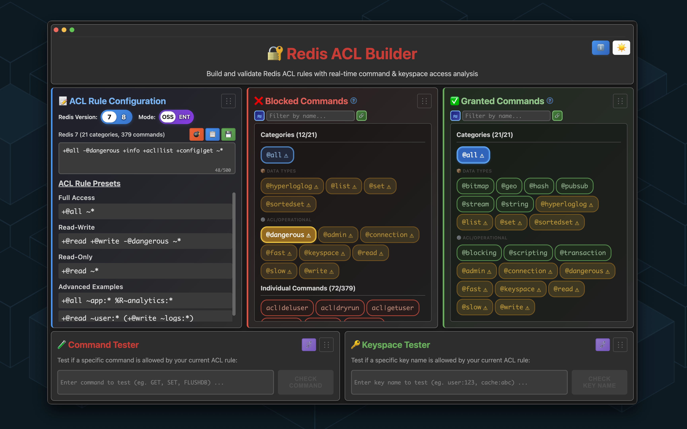

# Redis ACL Builder

A high-performance application for testing and validating Redis Access Control
List (ACL) rules with real-time command analysis and interactive visual
feedback.


> **Note:** Available as both a native desktop application and web/Docker
deployment. Desktop apps feature auto-updates, offline support, and native
performance without requiring Python installation.

📖 **[Visit the Wiki](https://github.com/markotrapani/redis-acl-builder/wiki)**
for comprehensive guides, tutorials, and documentation.



---

## 🚀 Quick Start

> 📖 **New to Redis ACL Builder?** Check out the [Getting Started
> Guide](https://github.com/markotrapani/redis-acl-builder/wiki/Getting-Started)
> in the wiki for a complete walkthrough.

### Option 1: Desktop App (Recommended for End Users)

📦 **[Download Latest
Release](https://github.com/markotrapani/redis-acl-builder/releases/latest)** -
Signed and notarized installers

**Features:** No Python required • Auto-updates • Offline support • Native
performance

> 📖 **Detailed installation instructions:** See the
> [Installation Guide](https://github.com/markotrapani/redis-acl-builder/wiki/Installation)
> in the wiki.

<!-- markdownlint-disable MD033 -->
<details>
<summary><b>📱 Installation Instructions (Click to expand)</b></summary>

**macOS:**

```bash
# Download the .dmg for your architecture
# - Redis-ACL-Builder-1.0.1-arm64.dmg (Apple Silicon - M1/M2/M3)
# - Redis-ACL-Builder-1.0.1-x64.dmg (Intel Macs)

# Install:
# 1. Open the DMG file
# 2. Drag "Redis ACL Builder" to Applications folder
# 3. Launch from Applications (app is signed and notarized - no security warnings!)
```

**Windows:**

```bash
# Download Redis-ACL-Builder-1.0.1-x64.exe
# Run the installer and follow the prompts
# App will be available in Start Menu
```

**Linux:**

```bash
# Download Redis-ACL-Builder-1.0.1-x86_64.AppImage
chmod +x Redis-ACL-Builder-1.0.1-x86_64.AppImage
./Redis-ACL-Builder-1.0.1-x86_64.AppImage
```

</details>
<!-- markdownlint-enable MD033 -->

### Option 2: Docker (Fastest for Servers/Web)

🐳 **[Docker Hub
Repository](https://hub.docker.com/r/markotrapani608/redis-acl-builder)** -
Latest builds with automated CI/CD

```bash
# Run the latest version directly from Docker Hub
docker run -d --name redis-acl-builder -p 7380:7380 --restart unless-stopped markotrapani608/redis-acl-builder:latest

# Access the application
open http://localhost:7380
```

<!-- markdownlint-disable MD033 -->
<details>
<summary><b>🔄 Upgrade Instructions (Click to expand)</b></summary>

```bash
# Stop, remove, and recreate the container with the latest image
docker pull markotrapani608/redis-acl-builder:latest && \
  docker rm -f redis-acl-builder && \
  docker run -d --name redis-acl-builder -p 7380:7380 \
    --restart unless-stopped markotrapani608/redis-acl-builder:latest

# Or use docker-compose (recommended)
docker compose pull && docker compose up -d
```

</details>
<!-- markdownlint-enable MD033 -->

### Option 3: Local Development Installation

**For developers:** Python 3.12+ required (the Docker image uses 3.13)

<!-- markdownlint-disable MD033 -->
<details>
<summary><b>💻 Development Setup (Click to expand)</b></summary>

1. **Download/Clone the project:**

   ```bash
   git clone https://github.com/markotrapani/redis-acl-builder.git
   cd redis-acl-builder
   ```

2. **Create virtual environment:**

   ```bash
   python -m venv venv
   source venv/bin/activate  # On Windows: venv\Scripts\activate
   ```

3. **Install dependencies:**

   ```bash
   pip install -r backend/requirements.txt
   ```

4. **Run the application:**

   ```bash
   # Option 1: Use helper script
   ./scripts/run-web.sh

   # Option 2: Run directly
   python backend/app.py
   ```

5. **Open your browser:**
   Navigate to `http://localhost:7380`

</details>

## Overview

Redis ACL Builder is a powerful tool that helps developers and system
administrators understand and test Redis ACL configurations before deploying
them to production.

> ⚠️ **Important:** This tool is designed based on **Redis OSS** (Open Source)
command sets, which are also compatible with **Redis Stack**. Redis Enterprise
may restrict certain OSS commands (cluster management, replication, dangerous
operations) for security reasons. If a command test fails in Redis Enterprise,
this is expected behavior - the command exists in OSS but is restricted in
Enterprise. See [Redis Enterprise vs
OSS](https://redis.io/docs/management/enterprise/) for details.

**Core Capabilities:**

- ✅ Parse and validate Redis ACL rule syntax with real-time feedback
- ✅ Test commands and keyspace patterns with dual testing interface
- ✅ Visualize granted/blocked commands organized by categories
- ✅ Support for Redis 7 (379 OSS / 305 Enterprise commands) and Redis 8
  (488 OSS / 440 Enterprise commands, including modules)
- ✅ Light/Dark mode theme system with localStorage persistence
- ✅ Available as web app (Docker/local) and native desktop app (macOS, Windows,
Linux)

## Usage Guide

> 📖 **Complete Usage Guide:** For detailed usage instructions, examples, and
> best practices, see the
> [User Guide](https://github.com/markotrapani/redis-acl-builder/wiki/User-Guide)
> in the wiki.
>
> ⚠️ **Important:** This tool is designed for testing and validating ACL rules
> in development/staging environments. Always test thoroughly before applying
> ACL rules to production Redis instances.

### Basic Usage

1. **Select Redis Version**: Choose between Redis 7 or Redis 8 using the radio
   buttons
2. **Enter ACL Rule**: Type your ACL rule in the text area (left column)
3. **Interactive Management**:
   - Click granted commands (center column) to revoke them
   - Click blocked commands (right column) to grant them
   - Use Submit Changes button when manually editing rules
   - **Keyboard Shortcuts**:
     - Press **Enter** to submit pending changes
4. **View Results**: See granted and blocked commands organized by categories
   and individual commands
5. **Test Commands**: Use the command tester at the top to check specific
   commands
6. **Search & Filter**: Use the search bars at the top of each column to filter
   categories and commands

> 💡 **Tip:** Use the dual testing interface at the top to test both commands and
key patterns simultaneously. Results show exactly which permissions are granted
or denied.

<details>
<summary><b>📝 ACL Rule Syntax (Click to expand)</b></summary>

> 📖 **Full syntax reference:** See the
> [User Guide](https://github.com/markotrapani/redis-acl-builder/wiki/User-Guide)
> for comprehensive ACL syntax documentation.

The application supports standard Redis ACL syntax:

#### Command and Category Rules

- `+@read` - Grant all read commands
- `-@write` - Deny all write commands  
- `+@all` - Grant all commands
- `+get` - Grant specific GET command
- `-flushdb` - Deny specific FLUSHDB command

#### Key Pattern Rules

- `~user:*` - Allow access to keys matching pattern
- `~cache:*` - Allow access to cache keys

#### Rule Examples

**Read-only access:**

```acl
+@read ~data:*
```

**Application user with restrictions:**

```acl
+@read +@write -@dangerous -@admin ~app:* ~session:*
```

**Developer access:**

```acl
+@all -flushdb -flushall -shutdown
```

**Monitoring user:**

```acl
+@read +info +ping +client
```

**Analytics user:**

```acl
+@read +@bitmap +@hyperloglog -@admin
```

</details>

### Command Testing

Use the **Command Tester** section to:

1. Enter a Redis command (e.g., `GET`, `SET`, `HGETALL`)
2. Click "Test Command"
3. See if the command is allowed and why
4. View which categories the command belongs to

## Production Deployment

### Basic Deployment

```bash
# Set production environment
export FLASK_ENV=production
export FLASK_DEBUG=False

# Run with Gunicorn
pip install gunicorn
PYTHONPATH=backend gunicorn --bind 0.0.0.0:7380 --workers 4 backend.app:app
```

### Docker Deployment (Recommended)

See **Quick Start** section above for Docker deployment options.

**Additional deployment configurations:**

```bash
# Specific version
docker run -d --name redis-acl-builder -p 7380:7380 --restart unless-stopped markotrapani608/redis-acl-builder:1.0.1

# Custom port mapping
docker run -d --name redis-acl-builder -p 8080:7380 --restart unless-stopped markotrapani608/redis-acl-builder:latest
```

<details>
<summary><b>🔌 API Endpoints (Click to expand)</b></summary>

> 📖 **Complete API documentation:** See the
> [API Reference](https://github.com/markotrapani/redis-acl-builder/wiki/API-Reference)
> for detailed endpoint documentation, request/response schemas, and examples.

The application provides a RESTful API for programmatic access:

### Core Endpoints

- `POST /api/parse` - Parse ACL rule and return granted commands
- `POST /api/test-command` - Test if a specific command is allowed
- `POST /api/validate-rule` - Validate ACL rule syntax
- `POST /api/command-info` - Get information about a command
- `GET /api/categories` - Get all available categories
- `POST /api/search-commands` - Search commands with patterns
- `GET /health` - Application health check

### Example API Usage

```bash
# Parse an ACL rule
curl -X POST http://localhost:7380/api/parse \
  -H "Content-Type: application/json" \
  -d '{"rule": "+@read -@dangerous", "version": "redis7"}'

# Test a command
curl -X POST http://localhost:7380/api/test-command \
  -H "Content-Type: application/json" \
  -d '{"rule": "+@read", "command": "GET", "version": "redis7"}'

# Validate rule syntax
curl -X POST http://localhost:7380/api/validate-rule \
  -H "Content-Type: application/json" \
  -d '{"rule": "+@read +get", "version": "redis7"}'
```

</details>

<details>
<summary><b>💻 Development (Click to expand)</b></summary>

> 📖 **Developer documentation:** See the
> [Development Guide](https://github.com/markotrapani/redis-acl-builder/wiki/Development)
> for detailed setup instructions, architecture overview, and contribution
> guidelines.

## Development

### Setting Up Development Environment

1. **Fork/Clone the repository**
2. **Create virtual environment:**

   ```bash
   python -m venv venv
   source venv/bin/activate
   ```

3. **Install dependencies:**

   ```bash
   pip install -r backend/requirements.txt
   npm install  # For E2E testing
   ```

4. **Run the application:**

   ```bash
   # Option 1: Use helper script
   ./scripts/run-web.sh

   # Option 2: Run directly
   python backend/app.py
   ```

5. **Run tests:**

   ```bash
   # Backend tests
   pytest tests/backend/ -v

   # E2E tests
   npx playwright test --config=tests/playwright.config.js
   ```

### Code Organization (Monorepo Structure)

- **Backend**: `backend/` - Python Flask app, helpers, models
- **Frontend**: `frontend/` - Static assets (CSS/JS) and templates
- **Scripts**: `scripts/` - Helper scripts (run-web.sh, build-web.sh)
- **Tests**: `tests/backend/` (pytest) and `tests/e2e/` (Playwright)
- **Electron**: `electron/` - Desktop app wrapper (see
  [docs/ROADMAP.md](docs/ROADMAP.md))

</details>

<details>
<summary><b>🧪 Testing (Click to expand)</b></summary>

> 📖 **Testing guidelines:** See the
> [Development Guide](https://github.com/markotrapani/redis-acl-builder/wiki/Development#testing)
> for detailed testing documentation and contribution workflow.

## Testing

The project includes a comprehensive test suite with 227 backend tests (pytest) and
65 end-to-end tests (Playwright).

### Test Coverage Summary

- **Overall Coverage**: 85%
- **Core Logic** (helpers/): 95-100%
- **API Endpoints**: 78%
- **All tests passing**: ✓

### Running Tests

#### Method 1: Backend Tests (Recommended)

```bash
# Run all backend tests
pytest tests/backend/ -v

# With coverage
pytest tests/backend/ --cov=backend --cov-report=html
```

#### Method 2: E2E Tests

```bash
# Run Playwright E2E tests
npx playwright test --config=tests/playwright.config.js

# Run in UI mode
npx playwright test --ui --config=tests/playwright.config.js
```

### Test Categories

- **Unit Tests**: Core functionality validation
  - Data loading and indexing
  - ACL rule parsing accuracy
  - Permission evaluation logic
  - Search and validation features

- **API Tests**: All endpoint validation
  - Request/response handling
  - Error cases and status codes
  - Version switching
  - Input validation

- **Integration Tests**: End-to-end scenarios
  - Complete workflow testing
  - Complex ACL rule patterns
  - Real-world use cases

</details>

<details>
<summary><b>🚀 CI/CD & Build System (Click to expand)</b></summary>

## CI/CD & Build System

**All automated builds are now managed in the redis-acl-builder repository.**

### GitHub Actions Workflows

**Repository**:
[github.com/markotrapani/redis-acl-builder/actions](https://github.com/markotrapani/redis-acl-builder/actions)

#### 🐳 Docker Builds (Web Application)

- **Workflow**: `.github/workflows/docker-publish.yml`
- **Triggers**: Version tags (`v*.*.*`, `v*.*.*-alpha`, `v*.*.*-beta`)
- **Platforms**: linux/amd64, linux/arm64 (multi-arch)
- **Outputs**: Docker images published to [Docker
  Hub](https://hub.docker.com/r/markotrapani608/redis-acl-builder)
- **Features**: Automated CVE scanning with Docker Scout

#### 💻 Desktop Builds (Electron App)

- **Workflow**: `.github/workflows/build-desktop.yml`
- **Triggers**: Version tags (`v*.*.*`, `v*.*.*-desktop*`) + manual dispatch
- **Platforms**: Windows (x64), macOS (ARM64 + Intel x64), Linux (x64)
- **Outputs**:
  - Windows: NSIS installer + ZIP
  - macOS: DMG + ZIP (separate ARM64 and Intel builds)
  - Linux: AppImage + .deb package
- **Features**: PyInstaller backend bundling, platform-specific installers

### Version Tag Strategy

**Fast macOS ARM64 build** (debugging/testing - ~2 minutes):

```bash
git tag v1.0.2-test && git push origin v1.0.2-test
git tag v1.0.2-debug && git push origin v1.0.2-debug
```

**Full multi-platform build** (production - ~5 minutes):

```bash
git tag v1.0.2-beta && git push origin v1.0.2-beta   # macOS, Windows, Linux + Docker
git tag v1.0.2-alpha && git push origin v1.0.2-alpha
git tag v1.0.2 && git push origin v1.0.2
```

**Docker build only** (web app):

```bash
git tag v1.0.2-docker && git push origin v1.0.2-docker
```

**Documentation updates only**:

```bash
git tag v1.0.2-docs && git push origin v1.0.2-docs
```

</details>

<details>
<summary><b>📁 Project Structure (Click to expand)</b></summary>

## Project Structure

```txt
redis-acl-builder/
├── backend/                    # Flask application
│   ├── app.py                 # Main Flask app
│   ├── helpers/               # Core logic modules
│   │   ├── data_loader.py    # Redis command database
│   │   └── acl_parser.py     # ACL parsing engine
│   ├── models/                # Data models
│   └── requirements.txt       # Python dependencies
├── frontend/                   # Web interface
│   ├── static/
│   │   ├── css/              # Modular CSS (6 files)
│   │   └── js/               # Modular ES6 JS (13 files)
│   └── templates/
│       └── index.html        # Main interface
├── electron/                   # Desktop app wrapper
│   ├── main.js               # Electron main process
│   ├── preload.js            # Preload script
│   └── package.json          # Electron config
├── scripts/                    # Helper scripts
│   ├── run-web.sh            # Start web app
│   └── build-web.sh          # Build script
├── tests/                      # Test suites
│   ├── backend/              # Backend tests (pytest)
│   └── e2e/                  # E2E tests (Playwright)
└── docs/                       # Documentation
    └── ROADMAP.md           # Product roadmap (includes desktop app details)
```

</details>

## 🏗️ Architecture

The application features modern, modular frontend and backend architectures with
a **monorepo structure**:

- **Monorepo**: Organized into `backend/`, `frontend/`, `electron/`, `scripts/`,
and `tests/` directories - single source of truth for both web app and Electron
desktop app
- **Frontend**: Modular ES6 JavaScript (13 modules) + Optimized Modular CSS (6
  modules) with professional desktop-like resize experience
- **Backend**: Flask with comprehensive Redis ACL parsing and API layer
- **Database**: Hardcoded Redis command databases based on **Redis OSS** (open
  source)
  - **Redis 7 OSS**: 379 commands across 21 categories (admin, cluster,
  replication, latency, module management, etc.)
  - **Redis 8 OSS**: 488 commands across 29 categories (includes RediSearch,
  JSON, TimeSeries, Bloom, and other module commands)
  - **Note**: Redis Enterprise blocks certain commands (cluster management,
  replication, dangerous operations) for security. If a command test fails in
  Redis Enterprise, this is expected behavior - the command exists in OSS but is
  restricted in Enterprise.
- **Testing**: 65 automated E2E tests (Playwright) with 100% pass rate
- **Type Safety**: Professional type annotations with 94% reduction in Pylance
  strict errors (comprehensive typing across all modules)
- **UI/UX**: Elegant resizable container system with real-time content
synchronization, drag-drop panel reordering, and perfect responsive design

## ✨ What's New

### v1.0.1 - Stability Patch

- **🩺 Health endpoint repaired**: Fixed `/health` endpoint and aligned backend
  tests so smoke checks pass against both Docker and desktop builds.
- **📦 Version sync**: `package-lock.json` and release artifacts now pinned to
  `1.0.1` consistently.
- **📖 Docs**: Confluence guide cleaned up to avoid version-number staleness.

### v1.0.0 - First Stable Release 🎉

- **🚀 Production Ready**: First non-beta release after extensive testing
  - 65/65 E2E tests passing (100%)
  - 227+ backend tests passing
  - Comprehensive manual testing completed
- **🏢 Enterprise/OSS Mode Toggle**: Toggle between Redis deployment types
  - Purple gradient for OSS mode, gold gradient for Enterprise mode
  - Dynamic command counts: Redis 7 (379 OSS / 305 ENT), Redis 8 (488 OSS / 440 ENT)
- **🖥️ Multi-Platform Desktop Apps**: Signed, notarized, auto-updating
  - macOS (ARM64 + Intel) - Signed and notarized
  - Windows (x64) - NSIS installer
  - Linux (x64) - AppImage
- **🐳 Docker Deployment**: Multi-arch images on Docker Hub
- **📖 Comprehensive Documentation**: Wiki, API reference, user guides

See [CHANGELOG.md](CHANGELOG.md) for the full pre-1.0 release history
(the `v2.x-beta` builds that led up to `v1.0.0`).

## Acknowledgments

Special thanks to **Michael Tchistopolskii** for substantial improvement ideas and
architectural guidance that helped shape the development of this application.

## License

Released under the [MIT License](LICENSE).

## Support

For questions, feedback, or issues:

1. **FAQ**: Check the
   [Frequently Asked Questions](https://github.com/markotrapani/redis-acl-builder/wiki/FAQ)
   wiki page
2. **Troubleshooting**: See the
   [Troubleshooting Guide](https://github.com/markotrapani/redis-acl-builder/wiki/Troubleshooting)
   for common issues and solutions
3. **Contact**: [Marko Trapani](https://github.com/markotrapani) - Project
   Developer
4. **Technical Issues**: Run `pytest tests/backend/test_imports.py` for
   diagnostics
5. **Test Verification**: Check results with
   `./tests/backend/run_tests.sh`
6. **Docker Deployment**: See [Docker Hub
   Repository](https://hub.docker.com/r/markotrapani608/redis-acl-builder)
7. **Setup Issues**: Ensure all files are in the correct locations per
   installation guide

---
